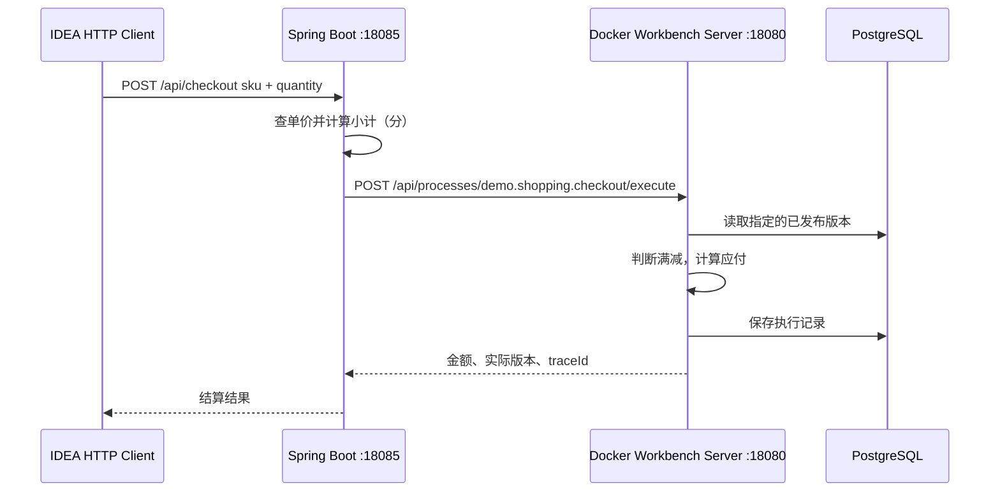

# 跟着敲：用 Workbench 做购物满减

> 已增加 Eureka + Gateway + 3 个 Workbench 节点 + 4 个购物节点的集群实验。完整启动和排查教程见 [cluster-docker/README.md](cluster-docker/README.md)。

集中查询 Workbench 容器日志和购物服务日志的步骤见 [Docker 日志采集实验](logging-docker/README.md)。

这次做一个结算报价接口。一本书 60 元，一支笔 15 元，商品小计满 100 元减 10 元。练习会把商品定价写在 Spring Boot 中，把满减判断和应付计算写进可视化流程。接口只返回报价。



浏览器的 Workbench 网页（5173）连接同一个 Server，用于编辑、发布和查日志。业务代码的 HTTP 目标是 18080。

## 1. 先跑一遍

打开 Docker Desktop。在已有用信模块的 Docker 部署目录运行 `docker compose up -d --wait`。如果工作台的 5173 网页没开，继续执行 `.\start-web.ps1`。详情见 [Docker 部署说明](../compileflow-credit-service/workbench-docker/README.md)。

在 IDEA 重新加载父项目 Maven，运行 `lab.shopping.ShoppingApplication`（JDK 17）。打开 [requests.http](requests.http)，点击请求上方的运行按钮。

| 输入 | 小计 | 优惠 | 应付 |
| --- | ---: | ---: | ---: |
| BOOK × 1 | 6000 分 | 0 分 | 6000 分 |
| BOOK × 2 | 12000 分 | 1000 分 | 11000 分 |
| PEN × 0 | HTTP 400 | | |

也可以从项目根目录打包，再启动应用。IDEA 和命令行任选一种。

```powershell
mvn -pl compileflow-shopping-demo package
java -jar .\compileflow-shopping-demo\target\compileflow-shopping-demo-1.0-SNAPSHOT.jar
```

## 2. 跟着写流程

打开 [checkout.bpm](checkout.bpm)。在 Workbench 的“运维 → 流程管理”找到 `demo.shopping.checkout`，点击“编辑”，切到“分栏”对照源码和画布。流程已经发布，可直接观察。

从声明一个入参、两个返回值开始。在新草稿里敲出以下三行，放在 `<bpm>` 内部。

```xml
<var name="subtotalCents" dataType="java.lang.Integer" inOutType="param"/>
<var name="discountCents" dataType="java.lang.Integer" inOutType="return"/>
<var name="payableCents" dataType="java.lang.Integer" inOutType="return"/>
```

1. 连接“开始 → 是否满 100 元？”；有条件的连线写 `subtotalCents >= 10000`，另一条连线留空作为默认分支。
2. 两个脚本节点分别写 `return 1000;` 和 `return 0;`，都把输出映射到 `discountCents`。
3. 两条分支接到“汇合”，再执行“计算应付金额”。脚本要用的变量通过 `input` 显式传入。

```xml
<action type="script" language="java">
    <input target="subtotalCents" dataType="java.lang.Integer" source="subtotalCents"/>
    <input target="discountCents" dataType="java.lang.Integer" source="discountCents"/>
    <output dataType="java.lang.Integer" target="payableCents"/>
    <code>return subtotalCents - discountCents;</code>
</action>
```

第一次在另一套 Docker 数据库练习时，到本模块目录执行 `.\publish.ps1`。它会先预览，再将本地文件创建为服务端草稿并发布，打印版本号。已有修改过的草稿时，脚本会保留它，请在网页发布该草稿。

## 3. 跟着写 Spring Boot

1. 在 [CheckoutController.java](src/main/java/lab/shopping/CheckoutController.java) 定义 `POST /api/checkout`，接收 `sku` 和 `quantity`。用目录单价乘数量，得到整数分 `subtotalCents`。
2. 在 [WorkbenchClient.java](src/main/java/lab/shopping/WorkbenchClient.java) 注入 URL 和版本，用 Spring 的 `RestClient` 发出 POST。先按以下请求体对照编写 Java 的两层 `Map`。将版本替换为实际发布返回的值。

```json
{
  "params": {"subtotalCents": 12000},
  "routing": {"version": "你的发布版本"}
}
```

3. 接收返回的 `success`、`result`、`traceId` 和 `routing.effectiveVersion`。将后两项带回购物接口，供排查问题时定位准确的那一次执行。连接失败或超时返回 503，上游请求或流程执行失败返回 502。
4. 在 [application.yml](src/main/resources/application.yml) 配置地址。默认版本是本机已经发布的版本。换数据库或练习发布新版本后，在 IDEA 运行配置的环境变量中设置 `SHOPPING_FLOW_VERSION=实际版本`，然后重启购物服务。

## 4. 发布新规则，看运行结果何时改变

1. 在流程管理中编辑购物草稿，把满减节点的脚本从 `return 1000;` 改成 `return 2000;`。保存并发布新版本。
2. 保持 Spring Boot 的旧版本配置，调用 BOOK × 2，预期仍是 11000 分。
3. 将 `SHOPPING_FLOW_VERSION` 指向刚发布的新版本，重启应用，调用同一个请求，预期变成 10000 分，且响应中的 `flowVersion` 已改变。
4. 从响应复制 `traceId`，打开 Workbench 的“运维 → 日志”，按流程 `demo.shopping.checkout` 查找并对照该次执行。也可以在浏览器打开 [该流程的日志接口](http://127.0.0.1:18080/api/execution-logs?processCode=demo.shopping.checkout&page=1&pageSize=20)，搜索此 ID。

把环境变量改回旧版本并重启即可恢复原规则。这个实验固定调用版本，便于同时比较两版；每次购物请求使用的是接口返回的 `flowVersion`。
